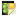
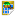

- Press ++ctrl+n++, ++e++ to create a new  Entity  

    
    

    ---
    Containers that can hold multiple child Item Nodes, allowing for hierarchical organization and transformation of grouped items. Entities can also animate their child nodes over time using Timelines.

    

    ---
    Efficiently design levels with a Tile Set that can be assembled using auto-tiling and a grid-based system with support for multiple layers and collision.
