---
title: "🔶Prefabs"
---

Prefabs are the components you use to build your game. They are created and edited within the **HyEditor** and then used in code to instanciate instances of the Prefab. Prefab instances can be used independently or combined together into more complex [Entities](../entities.md). There are several types of Prefabs, each serving a specific purpose, but they also have common concepts that apply to each of them.

## Creating new Prefabs

Within the [Project Explorer](../projects.md#project-explorer), to create a new Item you can :material-mouse-right-click:++right-button++ in the tree view on a 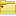 prefix folder and select `New Item > [select item]` to create an item at that location, or use one of the following methods:

- `File > New Prefab > [select type]` from the top menu
- Press ++ctrl+n++, ++s++ to create a new 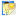 Sprite  
- Press ++ctrl+n++, ++t++ to create a new 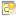 Text  
- Press ++ctrl+n++, ++f++ to create a new 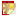 Particle FX  
- Press ++ctrl+n++, ++i++ to create a new 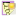 Spine  
- Press ++ctrl+n++, ++a++ to create a new 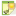 Audio  

You will be shown the "Add a new Prefab" dialog which will look like either of these:

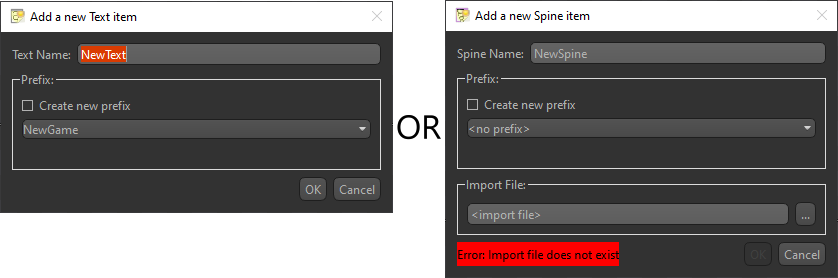

Specify the prefix and name you want for the Prefab. This is where it will be located in the Project Explorer, as well as its "path" to create an instance of it in code. `ex. "RootPrefix/SubPrefix/Name"` (Note prefixes and names are case insensitive)

Some Prefabs require an **Import File** upon creation. The browse button will open a file dialog with a filter for the expected file type. This file may be located anywhere, and is copied (along with any dependency files) into the project's meta-data.

After creation, the Prefab will be opened and the Properties window will be populated with widgets to modify the item. The center render preview will reflect changes made here.

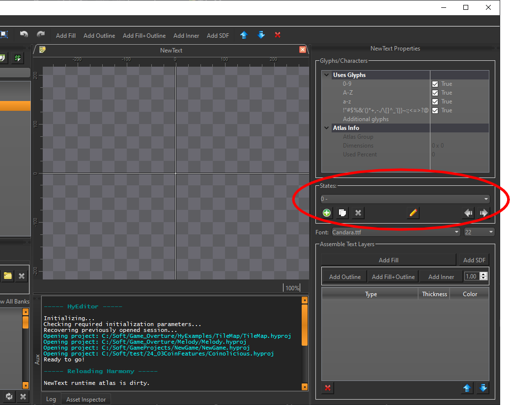

While each **Prefab** will have different properties, they all share the ability to set 'states' which is circled in red in the above image.

## Prefab States

Every **Prefab** utilizes the concept of 'states', regardless of which type it is. In the case of a sprite, this can be the different animations a character can do, like idle, walk, and jump. Or if the sprite is a framed painting wall decoration, each state could be a different piece of art. For a text item, each state might be the same font/style but at different sizes, or each state could be the font in regular, bold, and italic. Ultimately how you want to utilize the states for any given Prefab is up to you.

In every **Prefab**'s Properties window, you will find the States Groupbox that looks like this:

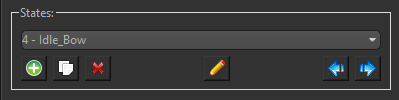{ align=left }

Within the example image's drop-down box, the "4" indicates which zero-based state index is currently selected, and "Idle_Bow" is the name given to the state. The names of states are only used on the Editor's side, and are accessed by numerical index in code.

Add new "blank" states by pressing the  button, or append a duplicate of the currently selected state with the  button. Rename the state with 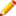, and arrange states by index with  and  buttons.

!!! tip "Widgets above and below the States Groupbox"
    In the Properties Window for each Prefab, widgets placed above the States Groupbox generally affect the Prefab overall, while widgets placed underneath the States Groupbox are properties that affect the currently selected state.

## Types

-   [ Sprite Prefabs](./sprites.md)  
    

    ---
    Textured quads capable of displaying single images or animated spritesheets.

-   [ Text Prefabs](./text.md)

    ---
    Render bitmap fonts with various font styles, outlines, sizes, and gradient colors.

-   [ Particle FX Items](./particles.md)  

    ---
    Create and manage particle effects on the CPU with various properties like lifetime, speed, and emission rate.

-   [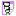 Spine Prefab](./spine.md)  
    

    ---
    Integrate 2D skeletal animations created with Spine, allowing for complex character animations with bones and meshes.

-   [ Model Prefab](./models.md)  

    ---
    Import GLTF 3D models that can be inserted into your scene's 2D display order as orthographic or perspective 3D objects.

-   [ Audio Items](./audio.md)  
    
    ---
    Audio cues or background music tracks that can be attached to entities for positional sound or simply played within your scenes.
  

