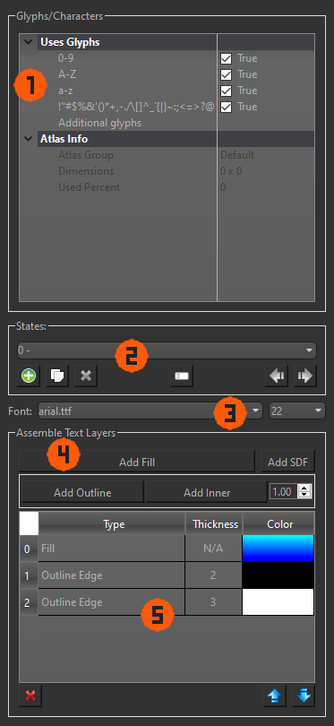

Text Prefabs initialize instances of `HyText` nodes, which utilize bitmap fonts and are able to batch render along with `HySprite2d`'s and `HyTextureQuad2d`'s. Creating Text Prefabs with HyEditor use the installed fonts on your PC.

HyEditor will scan your OS's standard location for available fonts. Creating Text Prefabs requires choosing a font file, and by default **System-wide** fonts installed on your PC and fonts found in the `<Project Location>/meta/Fonts` directory are available to choose from.  

Compatible fonts are **.ttf** (TrueType Fonts) and most **.otf** (OpenType Fonts).
!!! note "User-specific installed fonts will not be found"
    Only system-wide fonts that are accessible to all user accounts will be available to choose from. If you want to use a downloaded font, be sure to "Install for all users", or manually place the font in the `<Project Location>/meta/Fonts` directory.

## Properties

- :material-numeric-1-circle:{.hyindicator}ㅤ**Set Available Glyphs**  
  Specify every character/glyph upfront that text initialized by this Prefab might use. By default most alphanumeric and ASCII symbols are enabled. **Additional glyphs** can be specified to also allow accented letters or other symbols like ¢ (provided the font you choose supports it).  The more glyphs/characters that are enabled, the more texture space is required on the atlas. For instance if this Text Prefab will be used to show score, you may only want **0-9** checked (and maybe also **Additional glyphs** like `,` and/or `.` for digit separators).
- :material-numeric-2-circle:{.hyindicator}ㅤ**Configure States**  
  All Text states share the same available Glyphs/Characters available. Text states allow for different styles to be shown using the same texture resource. For instance you could have states use the same font/style but at different sizes, or each state could be the font in regular, bold, and italic.  
- :material-numeric-3-circle:{.hyindicator}ㅤ**Font and Size**  
  For the currently selected state, the specified font file and size that is applied to all the Text Layers (:material-numeric-4-circle:{.hyorange} and :material-numeric-5-circle:{.hyorange})
- :material-numeric-4-circle:{.hyindicator}ㅤ**Add Layer Buttons**  
  Text Layers are "render passes" over each glyph when it is displayed. At least one layer (usually starting with a `Fill`) is required to show anything.  These Layers can be combined to give this state's style an outline or shadow. Insert a `Fill` + multiple `Outline` to create strokes around the text or alternately insert a `Fill` and a single `SDF` layer which (depending on the font) can give a shadow-like effect.
- :material-numeric-5-circle:{.hyindicator}ㅤ**Layer List**  
  The table here lists all the layers this state uses, the order, and their attributes *Thickness* and *Color*. The order is important when combining multiple layers together. Typically `Fill` should be before an `Outline`, and an `Inner` before `Fill`.  You can double :material-mouse-left-click:++left-button++ on an attribute to change it. When using multiple outlines, they should have increasing thickness per acsending layer. Every layer type can apply a single color or 2 tone vertical gradient.  

    !!! tip "Text Colors"
        The colors specified in the Text Layers are just defaults. Every Text Layer in every State can be modified at run-time.

