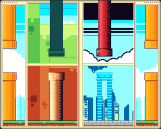
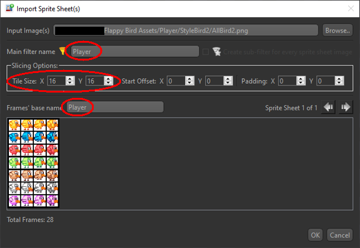
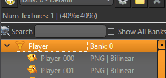
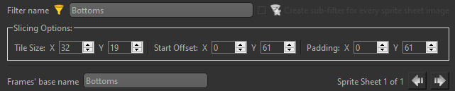

Our goal here is to speedrun a simple game to cover some of Harmony Engine's major features. It assumes you have already done the steps in the [Installation & Setup](install.md) section.

## 1. Create the Project

With HyEditor open go to `File > New Project` from the main menu which opens the **New Project** dialog.

<figure>
  
  <figcaption> See <a href="../editor/projects.html#creating-a-new-project">Projects</a> section for more information</figcaption>
</figure>

- Type the **Game Title** that you want, in our example it's "Flappy". The **Code Name** will update automatically to match, and will be used to name the main C++ class.
- Specify where you want this to game reside on your PC using **Project Location** and leave the rest default.
- Press OK

The  Flappy project should now appear in the [Project Explorer](../editor/projects.md#project-explorer) window. Click the project to activate it .

<h3>Generate a build<h3>

With your project activated the [Asset Manager](../editor/asset-manager.md) (and everything else) will now be linked to this project. Click the  Code tab within it.

Press the  button to generate a new build. If you are using Visual Studio, it should detect your version. Use the other default values and press OK.

In the background HyEditor will generate the build within your **Project Location**, but all configuration for it can be done within HyEditor.
Once the build has fully generated you can click  to launch Visual Studio (or whatever else you configured). We'll begin coding later on, but it should build and run an empty window at this point.

!!! warning "Don't use Visual Studio (or any external tool) to modify the build settings"
    Adding or Removing files, creating folders, modifying code dependencies or other build settings should all be done within HyEditor. When changes are made in HyEditor it informs and updates CMake. Visual Studio will detect the change upon `Build Solution` and refresh.

## 2. Import Assets

Download the following free asset packs that will be used in this example:

-   [:material-palette-outline:{.hyindicator}ㅤ**Flappy Bird Assets**](https://megacrash.itch.io/flappy-bird-assets)  
    Pixel Art by MegaCrash on itch.io 
    

-   [:material-volume-high:{.hyindicator}ㅤ**Impact Sounds!**](https://nvthicprod.itch.io/impact-sfx)  
    Sound Effects by Nvthic Sounds on itch.io 
    

You can extract the zip files anywhere on your PC. The assets will be copied into the project when importing below (no longer referencing the original location).

<h3>Player Assets</h3>

Continuing with the [Asset Manager](../editor/asset-manager.md), click the  Atlases tab within it.

Press the  button at the bottom to **Import a Sprite Sheet**

<figure>
  
  <figcaption></figcaption>
</figure>

- Click `Browse..` and locate the extracted `Flappy Bird Assets/Player` directory and choose from either style, selecting either `AllBird1.png` or `AllBird2.png`
- Rename "Filter name" to `Player`
- Change the Tile Size X and Y to be `16`
- Rename "Frames' base name" to be `Player`
- You can zoom/pan the preview window with ++w++ ++a++ ++s++ ++d++ and ++middle-button++ :material-mouse-scroll-wheel:
- Press OK, and confirm importing 28 assets.

You should now have a new filter in the tree view called `Player` that contains the 28 sliced images.

!!! tip annotate "Specify where new assets and filters get placed into"
    In the Asset Manager, what you have selected determines where new items are placed into. To place new items to the root (and not within the `Player` filter) make sure to deselect all items by clicking an empty region in the Atlas Manager's tree view. (1)

1. 

<h3>Pipe Assets</h3>

Within the [Asset Manager](../editor/asset-manager.md), right-Click :material-mouse-right-click: an empty region in the tree view and select " Add Filter" in the context menu. Name it `Pipes`, press OK, then select the newly created filter by clicking it.

Press the  button again, but this time we'll need to adjust the slicing options. Starting with slicing the **Tops**.

<figure>
  
  <figcaption></figcaption>
</figure>

- Click `Browse..` and locate the extracted `Flappy Bird Assets/Tiles` directory and choose a style, selecting either `PipeStyle1.png`, or `PipeStyle2.png`, etc.
- Rename "Filter name" and "Frames' base name" to be `Tops`
- Depending on which style you choose your slicing options will vary.

!!! tip "Setting Slicing Options"
    You can use your mouse wheel :material-mouse-scroll-wheel: to change slicing option values and preview the changes quickly.

Select the `Pipes` filter you created earlier and repeat the  process for the **Bodies** and then **Bottoms**. For `PipeStyle1.png`, the slicing options values are shown here:

<h3>Ground Assets</h3>

Within the [Asset Manager](../editor/asset-manager.md), right-Click :material-mouse-right-click: an empty region in the tree view and select " Import Sprite Sheet(s)" in the context menu.

<figure>
  
  <figcaption></figcaption>
</figure>

- Click `Browse..` and locate the extracted `Flappy Bird Assets/Tiles` directory and choose a style, selecting either `SimpleStyle1.png`, or `SimpleStyle2.png`, etc.
- Rename "Filter name" and "Frames' base name" to be `Ground`
- Depending on which style you choose your slicing options will vary.

<h3>Background Assets</h3>

Within the [Asset Manager](../editor/asset-manager.md), right-Click :material-mouse-right-click: an empty region in the tree view and select " Add Filter" in the context menu. Name it `Backgrounds`, press OK, then select the newly created filter by clicking it.
  
The backgrounds are individual images so we can simply press the  button, browse to the extracted `Flappy Bird Assets\Background` directory and select 1 or more background images that you want.
  
This example is going to cycle day and nights as a run progresses using images: `Background1.png`, `Background2.png`, `Background3.png`, `Background4.png`, `Background5.png`, and `Background6.png`

<figure>
  
  <figcaption>Your <a href="../editor/asset-manager.html">Asset Manager</a> should look something like this</figcaption>
</figure>

## 3. Create the Prefabs

## 4. Write the Game

