Our goal here is to speedrun a simple game to cover some of Harmony Engine's major features. It assumes you have already done the steps in the [Installation & Setup](install.md) section.

## 1. Create the Project

With HyEditor open go to `File > New Project` from the main menu which opens the **New Project** dialog.

<figure>
  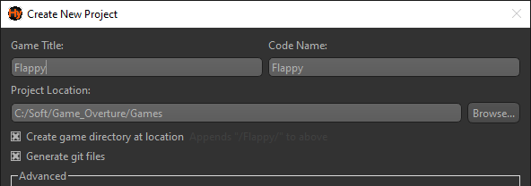
  <figcaption> See <a href="../editor/projects.html#creating-a-new-project">Projects</a> section for more information</figcaption>
</figure>

- Type the **Game Title** that you want, in this example it's "Flappy". The **Code Name** will update automatically to match, and will be used to name the main C++ class.
- Specify where you want this to game reside on your PC using **Project Location** and leave the rest default.
- Press OK

The  Flappy project should now appear in the [Project Explorer](../editor/projects.md#project-explorer) window. Click the project to activate it .

<h3>Generate a build<h3>

With your project activated the [Asset Manager](../editor/asset-manager.md) (and everything else) will now be linked to this project. Click the  Code tab within it.

Press the  button to generate a new build. If you are using Visual Studio, it should detect your version. Use the other default values and press OK.

In the background HyEditor will generate the build within your **Project Location**, but all configuration for it can be done within HyEditor.
Once the build has fully generated you can click  to launch Visual Studio (or whatever else you configured). We'll begin coding later on, but it should build and run an empty window at this point.

!!! warning "Don't use Visual Studio (or any external tool) to modify the build settings"
    Adding or Removing files, creating folders, modifying code dependencies or other build settings should all be done within HyEditor. When changes are made in HyEditor it informs and updates CMake. Visual Studio will detect the change upon `Build Solution` and refresh.

## 2. Import Assets

Download the following free asset packs that will be used in this example:

-   [:material-palette-outline:{.hyindicator}ㅤ**Flappy Bird Assets**](https://megacrash.itch.io/flappy-bird-assets)  
    Pixel Art by MegaCrash on itch.io 
    

-   [:material-volume-high:{.hyindicator}ㅤ**Impact Sounds!**](https://nvthicprod.itch.io/impact-sfx)  
    Sound Effects by Nvthic Sounds on itch.io 
    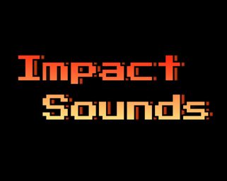

You can extract the zip files anywhere on your PC. The assets will be copied into the project when importing below (no longer referencing the original location).

<h3>Player Assets</h3>

Continuing with the [Asset Manager](../editor/asset-manager.md), click the  Atlases tab within it.

Press the  button at the bottom to **Import a Sprite Sheet**

<figure>
  
  <figcaption></figcaption>
</figure>

- Click `Browse..` and locate the extracted `Flappy Bird Assets/Player` directory and choose from either style, selecting either `AllBird1.png` or `AllBird2.png`
- Rename "Filter name" to `Player`
- Change the Tile Size X and Y to be `16`
- Rename "Frames' base name" to be `Player`
- You can zoom/pan the preview window with ++w++ ++a++ ++s++ ++d++ and ++middle-button++ :material-mouse-scroll-wheel:
- Press OK, and confirm importing 28 assets.

You should now have a new filter in the tree view called `Player` that contains the 28 sliced images.

!!! tip annotate "Specify where new assets and filters get placed into"
    In the Asset Manager, what you have selected determines where new items are placed into. To place new items to the root (and not within the `Player` filter) make sure to deselect all items by clicking an empty region in the Atlas Manager's tree view. (1)

1. 

<h3>Pipe Assets</h3>

Within the [Asset Manager](../editor/asset-manager.md), right-Click :material-mouse-right-click: an empty region in the tree view and select " Add Filter" in the context menu. Name it `Pipes`, press OK, then select the newly created filter by clicking it.

Press the  button again, but this time we'll need to adjust the slicing options. Starting with slicing the **Tops**.

<figure>
  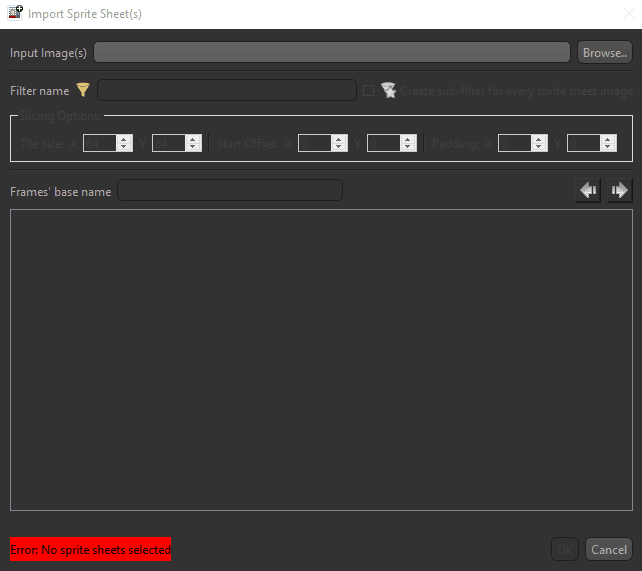
  <figcaption></figcaption>
</figure>

- Click `Browse..` and locate the extracted `Flappy Bird Assets/Tiles` directory and choose a style, selecting either `PipeStyle1.png`, or `PipeStyle2.png`, etc.
- Rename "Filter name" and "Frames' base name" to be `Tops`
- Depending on which style you choose your slicing options will vary.

!!! tip "Setting Slicing Options"
    You can use your mouse wheel :material-mouse-scroll-wheel: to change slicing option values and preview the changes quickly.

Select the `Pipes` filter you created earlier and repeat the  process for the **Bodies** and then **Bottoms**. For `PipeStyle1.png`, the slicing options values are shown here:

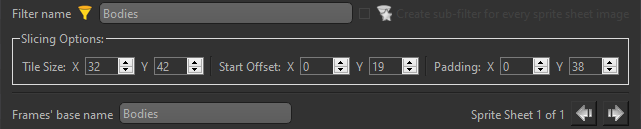

<h3>Ground Assets</h3>

Within the [Asset Manager](../editor/asset-manager.md), right-Click :material-mouse-right-click: an empty region in the tree view and select " Import Sprite Sheet(s)" in the context menu.

<figure>
  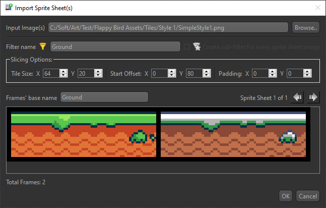
  <figcaption></figcaption>
</figure>

- Click `Browse..` and locate the extracted `Flappy Bird Assets/Tiles` directory and choose a style, selecting either `SimpleStyle1.png`, or `SimpleStyle2.png`, etc.
- Rename "Filter name" and "Frames' base name" to be `Ground`
- Depending on which style you choose your slicing options will vary.

<h3>Background Assets</h3>

Within the [Asset Manager](../editor/asset-manager.md), right-Click :material-mouse-right-click: an empty region in the tree view and select " Add Filter" in the context menu. Name it `Backgrounds`, press OK, then select the newly created filter by clicking it.
  
The backgrounds are individual images so we can simply press the  button, browse to the extracted `Flappy Bird Assets\Background` directory and select 1 or more background images that you want.
  
This example is going to cycle day and nights as a run progresses using images: `Background1.png`, `Background2.png`, `Background3.png`, `Background4.png`, `Background5.png`, and `Background6.png`

<figure>
  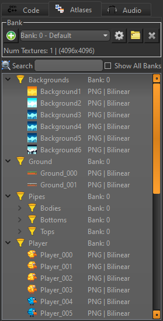
  <figcaption>Your <a href="../editor/asset-manager.html">Asset Manager</a> should look something like this</figcaption>
</figure>

## 3. Create the Prefabs

Prefabs are used to initalize components like sprites and text when programming the game. They are created and arranged into *prefixes*(1) in the [Project Explorer](../editor/projects.md#project-explorer) window.
{ .annotate }

1. Prefixes are a folder hierarchy that can be used to organize [Prefabs](../editor/prefabs/index.md) and [Entities](../editor/entities.md) into logical groups and help avoid name clashing. The full path includes the prefix and name, creating a string that is case-insensitive, delimited with `/`s. For example: "RootPrefix/SubPrefix/PrefabName"

<!-- ------------------------------------------------------------------------------------------------------------------------------- -->

<h3>Player Prefab</h3>

- Right-click :material-mouse-right-click: on your active project  **Flappy**
- Select **New Item**→ **New Sprite** in the context menu
- Set the "Sprite Name" to be `Player`, and leave the rest default
- Press OK

<figure>
  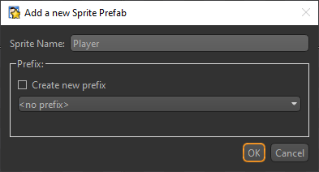
  <figcaption>Not setting a prefix will place it in the root, and its path is just the name "Player"</figcaption>
</figure>

- Choose a color among the imported player frames within the [Asset Manager](../editor/asset-manager.md)
- The  **Player** sprite is going to have three states: `Idle`, `Flap`, and `Bonk`

<figure>
  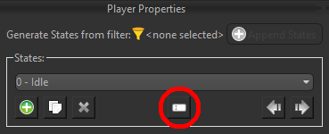
  <figcaption>Begin by renaming state '0' to `Idle`</figcaption>
</figure>

<figure>
  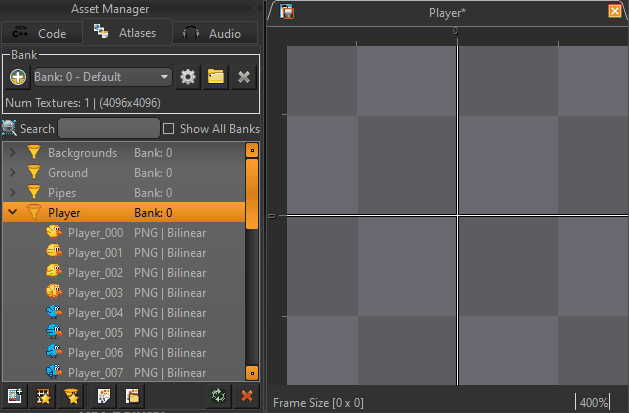
  <figcaption>Drag the first 2 player frames from the chosen color into the main window</figcaption>
</figure>

<figure>
  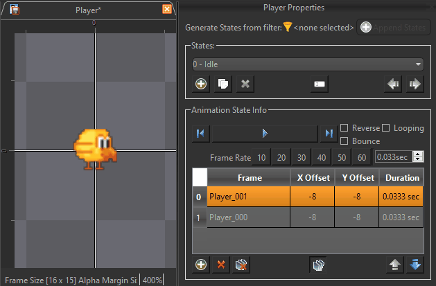
  <figcaption>Check the Looping checkbox, and set the Frame Rate to <code>0.250sec</code></figcaption>
</figure>

<figure>
  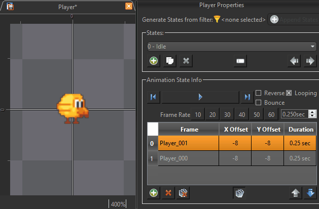
  <figcaption>Create the <code>Flap</code> state, drag all 4 frames into the main window, check the Bounce checkbox, and set the Frame Rate to <code>0.050sec</code></figcaption>
</figure>

<figure>
  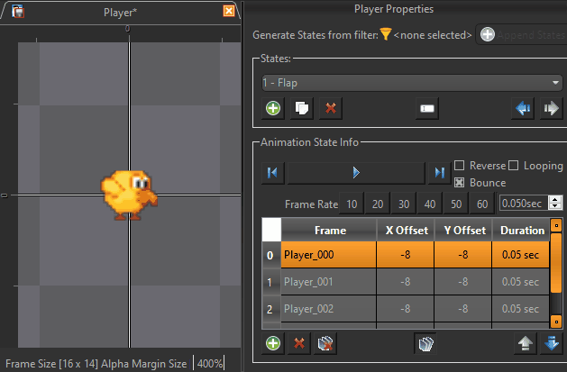
  <figcaption>Finally create the <code>Bonk</code> state, drag all 4 frames into the main window again, check the Looping checkbox, and crank up the Frame Rate</figcaption>
</figure>

!!! tip "Save your work"
    Be sure to **File**→ **Save** or press ++ctrl++ + ++s++ when you make changes to Prefabs

<!-- ------------------------------------------------------------------------------------------------------------------------------- -->

<h3>Pipe Prefabs</h3>

Creating the pipe Prefabs will be a little different. Pipes will be assembled between three Prefabs `Top`, `Body`, and `Bottom`, where each state will correspond to a color.

- Right-click :material-mouse-right-click: on your active project  Flappy
- Select **New Item**→ **New Prefix** in the context menu
- Set the "Prefix Name" to be `Pipes`, and leave the rest default, and press OK

 

- Now right-click :material-mouse-right-click: on the newly created  **Pipes** prefix
    - Select **New Item**→ **New Sprite** in the context menu
- Set the "Sprite Name" (`Top`, `Body`, or `Bottom`), the Prefix will already have `Pipes` set since our context menu was invoked from it
- Press OK

<figure>
  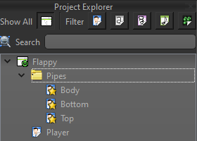
  <figcaption></figcaption>
</figure>

- Within [Asset Manager](../editor/asset-manager.md)'s tree view, the  **Pipes** filter has a sub-filter for each pipe Prefab `Top`, `Body`, and `Bottom`
- Drag a single corresponding pipe frame into the main view and then create a new state, repeating for each color
    - Should be 8 states total (0-7)
    - Make sure to keep the state/color order between the three pipe Prefabs the same

<figure>
  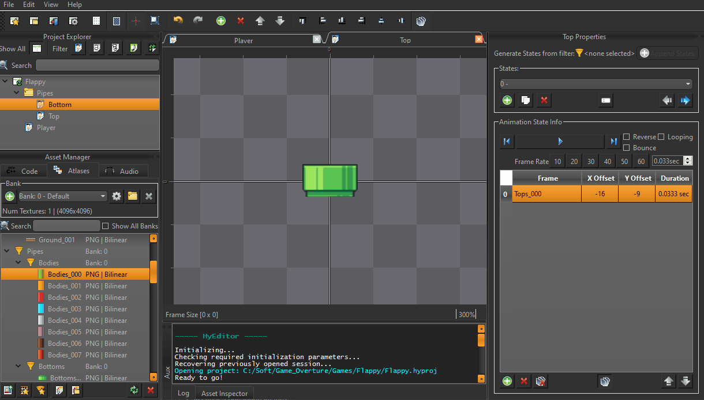
  <figcaption>Repeat this process three times in the Pipes prefix creating <b>Body</b>, <b>Bottom</b> and <b>Top</b></figcaption>
</figure>

<!-- ------------------------------------------------------------------------------------------------------------------------------- -->

<h3>Text Prefab</h3>

<figure>
  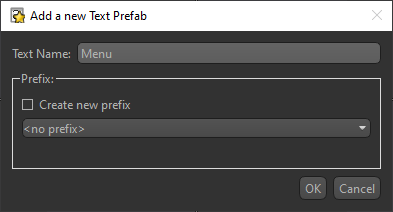
  <figcaption>Not setting a prefix will place it in the root, and its path is just the name "Menu"</figcaption>
</figure>

- Right-click :material-mouse-right-click: on your active project  Flappy
- Select **New Item**→ **New Text** in the context menu
- Set the "Text Name" to be `Menu`, and leave the rest default
- Press OK

## 4. Write the Game

