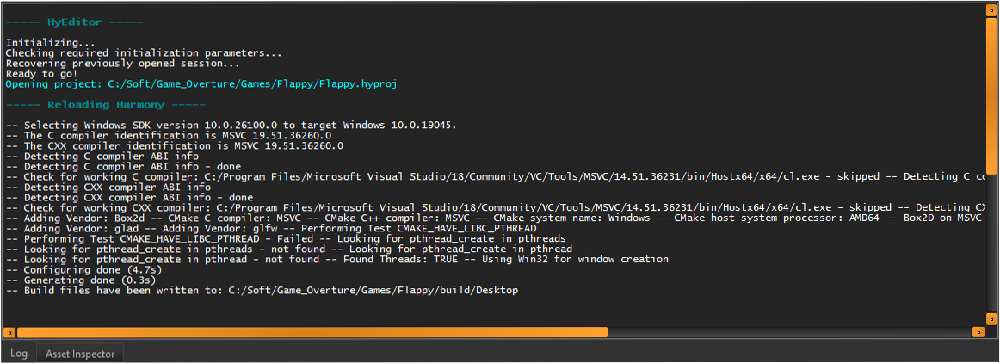

Our goal here is to speedrun a simple game to cover some of Harmony Engine's major features. It assumes you have already done the steps in the [Installation & Setup](install.md) section.

## Create the Project

With HyEditor open go to `File > New Project` from the main menu which opens the **New Project** dialog.

<figure>
  
  <figcaption> See <a href="../editor/projects.html#creating-a-new-project">Projects</a> section for more information</figcaption>
</figure>

- Type the **Game Title** that you want, in our example it's "Flappy". The **Code Name** will update automatically to match, and will be used to name the main C++ class.
- Specify where you want this to game reside on your PC using **Project Location** and leave the rest default.
- Press OK

The  Flappy project should now appear in the [Project Explorer](../editor/projects.md#project-explorer) window. Click the project to activate it .

<h3>Generate a build<h3>

With your project activated the [Asset Manager](../editor/asset-manager.md) (and everything else) will now be linked to this project. Click the  Code tab within it.

Press the  button to generate a new build. If you are using Visual Studio, it should detect your version. Use the other default values and press OK.

In the background HyEditor will generate the build within your **Project Location**, but all configuration for it can be done within HyEditor.
Once the build has fully generated you can click  to launch Visual Studio (or whatever else you configured). We'll begin coding later on, but it should build and run an empty window at this point.

!!! warning "Don't use Visual Studio (or any external tool) to modify the build settings"
    Adding or Removing files, creating folders, modifying code dependencies or other build settings should all be done within HyEditor. When changes are made in HyEditor it informs and updates CMake. Visual Studio will detect the change upon `Build Solution` and refresh.

## Setup Assets

Download the following asset packs that will be used in this example:

-   [:material-palette-outline:{.hyindicator}ㅤ**Flappy Bird Assets**](https://megacrash.itch.io/flappy-bird-assets)  
    Pixel Art by MegaCrash on itch.io 
    

-   [:material-volume-high:{.hyindicator}ㅤ**Impact Sounds!**](https://nvthicprod.itch.io/impact-sfx)  
    Sound Effects by Nvthic Sounds on itch.io 
    

You can extract the zip files anywhere on your PC. The assets will be copied into the project when importing below (no longer referencing the original location).

Continuing with the [Asset Manager](../editor/asset-manager.md), click the  Atlases tab within it.

Press the  button at the bottom to **Import a Sprite Sheet**

<figure>
  
  <figcaption></figcaption>
</figure>

- Click `Browse..` and locate the extracted `Flappy Bird Assets/Player` directory and choose from either style, selecting either `AllBird1.png` or `AllBird2.png`
- Change the Tile Size X and Y to be `16`
- You can zoom/pan the preview window with ++w++ ++a++ ++s++ ++d++ and ++middle-button++ :material-mouse-scroll-wheel:
- Press OK, and confirm importing assets.

## Create the Prefabs

## Write the Game

